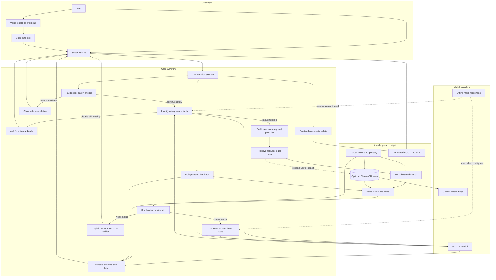
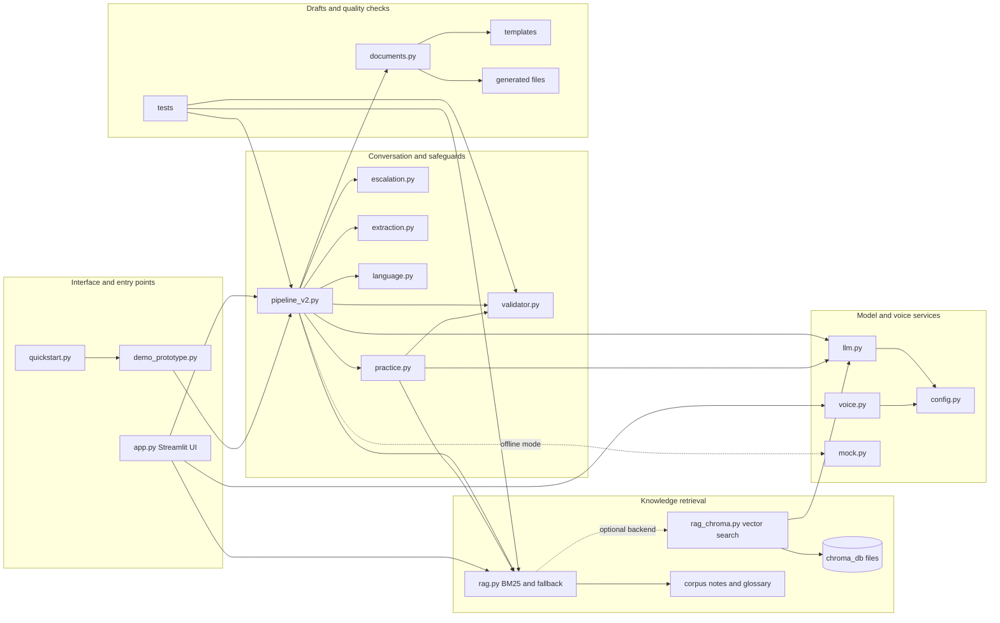

# ⚖️ AI Lawyer for Everyday Problems in India


This project is a conversational assistant for people trying to understand common legal problems in India. It accepts text and voice input and supports English, Hindi, and Hinglish; Bengali and Assamese support depends on the selected language model.

1. **Security deposit not returned** by a landlord
2. **Refund / defective goods or service** (consumer complaint)
3. **Unpaid salary / wages**
4. **Civil disputes** (contract breach, money recovery, property, cheque bounce)
5. **General information on family matters** (divorce, maintenance, custody, domestic violence)

The assistant gathers details, prepares a timeline and proof checklist, and explains possible next steps in plain language. For supported categories, it can also create a draft notice or complaint and offer a practice conversation. It provides *legal information, not legal advice*. When a question needs professional help, it directs the user to a lawyer or legal aid, including DLSA and the NALSA helpline (15100).

The default retrieval mode is local BM25 keyword search. Real model and speech features can use Groq or Google Gemini APIs; text-to-speech uses gTTS. API availability and free-tier limits can change, so check the providers' current terms before relying on them.

---

## Getting started

```bash
cd ai_lawyer
python -m venv .venv
source .venv/bin/activate            # Windows: .venv\Scripts\activate
pip install -r requirements.txt
cp .env.example .env                 # Windows: copy .env.example .env
```

To use real model responses, add the API key or keys you plan to use to `.env`:
* Groq (also gives free speech-to-text): https://console.groq.com/keys → `GROQ_API_KEY=`
* Gemini: https://aistudio.google.com/apikey → `GEMINI_API_KEY=`
* `LLM_PROVIDER=groq,gemini` tries Groq first, then Gemini if the first provider is unavailable. You can configure either provider on its own.

```bash
python -m pytest tests -q            # offline tests; no API key needed
streamlit run app.py                 # opens http://localhost:8501
```

You can run the scripted demo and offline tests without API keys. With `LLM_PROVIDER=mock`, the project uses its rule-based mock instead of a real model; those responses are for demonstration, not production use.

> If you get a "model not found" error, free-tier model names change over time. Look up the current model names in the Groq / Google AI Studio docs and edit `GROQ_MODEL` / `GEMINI_MODEL` in `.env`.

### Run an evaluation

```bash
python tests/run_eval.py --provider groq,gemini --delay 4
```

This runs the evaluation cases with the selected providers and writes raw output files, `metrics.json`, and `REPORT.md` under `tests/outputs/`. The delay can help reduce rate-limit errors. Review both the metrics and failed cases before sharing results. Mock-mode output is useful for checking the evaluation flow, but it does not measure real model performance.

---

## Knowledge base

The corpus is organized into topic-specific Markdown files. The counts and coverage below describe the current project data and should be rechecked whenever the corpus changes.

| Area | Current project notes |
|---|---|
| Corpus size | Project materials report 175 chunks across legal topics. |
| Verification metadata | Corpus entries include verification fields. Check each note's source and status before relying on it. |
| State rent coverage | State-specific material is included for a number of states; coverage varies by state and topic. |
| Topics | Deposit, consumer, salary, civil, family, and general legal information. |
| Glossary | Hindi and Hinglish legal terms are listed in `corpus/glossary.json`. |

Topics represented in the corpus include:
- **Deposit**: Model Tenancy Act material and state-specific rent-law notes, including notes for Maharashtra, Delhi, Karnataka, Tamil Nadu, West Bengal, Haryana, Punjab, UP, Gujarat, Rajasthan, MP, Bihar, Odisha, Kerala, Assam, and AP/Telangana
- **Consumer**: CPA 2019 (filing, fees, limitation, appeals, product liability, unfair contracts, e-commerce, CCPA)
- **Salary**: Code on Wages 2019 (effective Nov 2025), BNSS 144 (ex-CrPC 125), Bonus/Gratuity/PF/ESI, written demand format
- **Civil**: CPC (jurisdiction, suits, injunctions, execution, ADR, summary suits), Specific Relief 2018, Contract Act, NI Act 138/142/143A/148, Arbitration, Commercial Courts, RERA, MSME, IBC, Partnership
- **Family**: HMA, PWDVA, BNSS 144, Muslim/Christian/Special Marriage Acts, Hindu Succession 2005, Senior Citizens Act, live-in rights, child marriage
- **General**: Free legal aid (DLSA/NALSA 15100), legal notice format, evidence preservation, Limitation Act, RTI, FIR/Zero FIR, bail types, cognizable vs non-cognizable, mediation/Lok Adalat, stamp duty, registration, PoA, affidavit, 65B certificate

### Before a presentation or real-world use

| Check | Why it matters |
|---|---|
| Keep API keys in `.env` and out of source control | Keys should not be shared or committed. |
| Add a suitable font under `assets/fonts/` if Hindi PDFs are needed | Without a compatible font, some non-Latin text may not render correctly in PDF. DOCX output may be a better option. |
| Recheck helpline numbers, fees, and deadlines | These details can change; confirm them against current official sources. |
| Review retrieval and escalation thresholds | `LARGE_AMOUNT_THRESHOLD`, `MIN_RETRIEVAL_SCORE`, and related settings affect when the app adds warnings or returns an uncertainty response. |
| Run and inspect an evaluation with the intended provider | Results depend on the provider and model version. Update cases in `tests/cases.json` to reflect the scenarios you want to test. |

---

## Project architecture

AI Lawyer is a Python application with a Streamlit interface, a session-based workflow, a Markdown knowledge base, and optional external model services. The app checks for safety concerns first, then gathers the facts and searches for relevant notes. It checks generated answers against the retrieved material before displaying them.

### User workflow

The diagram follows a message from text or voice input through safety checks, fact gathering, and the final response. Drafting and practice are optional.

<!-- mermaid-checked: no \n, no em-dash/en-dash, no {} in labels, subgraphs are id["label"], arrows are -->|"label"|, all subgraphs closed by end, ids unique -->


### How the code fits together

This view shows how the main project files fit together. `app.py` provides the interface, while `pipeline_v2.py` coordinates each case.

<!-- mermaid-checked: no \n, no em-dash/en-dash, no {} in labels, subgraphs are id["label"], arrows are -->|"label"|, all subgraphs closed by end, ids unique -->


### Component inventory

| File or folder | Layer | Responsibility |
|---|---|---|
| `app.py` | User interface | Streamlit chat, language selection, voice controls, case summary, source display, draft downloads, and practice controls |
| `lawyer/pipeline_v2.py` | Application workflow | Maintains a conversation session and coordinates safety checks, fact collection, retrieval, answers, drafting, and practice |
| `lawyer/escalation.py` | Safety | Detects high-risk or out-of-scope messages using deterministic rules and prepares escalation guidance |
| `lawyer/extraction.py` | Case intake | Defines facts needed by each supported category, merges extracted information, and selects follow-up questions |
| `lawyer/language.py` | Language support | Detects English, Hindi, Hinglish, Bengali, and Assamese text |
| `lawyer/rag.py` | Knowledge retrieval | Parses corpus files, builds BM25 search, filters by topic, and falls back when vector search is unavailable |
| `lawyer/rag_chroma.py` | Optional knowledge retrieval | Creates and queries a persistent ChromaDB vector index using Gemini embeddings |
| `lawyer/llm.py` | Model integration | Calls configured Groq and Gemini models, handles provider fallback, parses JSON, and redacts API keys in errors |
| `lawyer/voice.py` | Voice integration | Sends audio for speech recognition and can create spoken replies with gTTS for supported languages |
| `lawyer/validator.py` | Output safeguards | Checks citations, sections, Act names, and case-law references against corpus material |
| `lawyer/documents.py` | Document generation | Renders Jinja2 templates and exports draft documents to DOCX and PDF |
| `lawyer/practice.py` | Practice feature | Runs the other-party role-play and produces feedback using retrieved context |
| `lawyer/mock.py` | Offline support | Supplies rule-based understanding and answers for demonstrations and tests without real model calls |
| `lawyer/config.py` | Configuration | Reads environment variables and defines model, retrieval, corpus, template, output, and threshold settings |
| `corpus/` | Knowledge content | Markdown legal notes and a language glossary consumed by the retrieval layer |
| `templates/` | Document content | Draft templates for deposit notices, consumer complaints, wage demands, and civil notices |
| `generated/` | Local output | Stores generated DOCX and PDF files under a case-specific output folder |
| `chroma_db/` | Local index data | Persistent vector-index files when the optional ChromaDB backend is used |
| `tests/` | Quality checks | Offline unit tests, evaluation cases, an evaluation runner, and saved evaluation outputs |
| `docs/DEMO_SCRIPT.md` | Demo guide | Suggested three-minute product demonstration |

### Features and boundaries

| Category or feature | What the project does |
|---|---|
| Security deposit | Collects case facts, retrieves relevant tenancy notes, and can prepare a deposit notice |
| Consumer dispute | Covers refund, defective goods, and service complaints; can prepare a consumer complaint draft |
| Unpaid salary | Collects employment and wage facts, retrieves wage notes, and can prepare a demand notice |
| Civil dispute | Provides supported general information and can prepare a civil notice draft |
| Family matter | Provides limited general information and escalation; it does not draft family-court documents |
| Practice mode | Lets the user rehearse selected deposit, consumer, salary, or civil conversations and receive feedback |
| Voice | Supports speech input through configured Groq or Gemini services; gTTS output is available for supported languages |
| Language | English, Hindi, and Hinglish are core interface languages; Bengali and Assamese depend on model support |

The five categories do not all have identical capabilities. Family matters are informational and should be handled with a qualified lawyer; drafting and practice are only available for the categories supported by their respective templates and role-play logic.

### Technology stack

| Area | Technology | Role |
|---|---|---|
| Application language | Python | Implements the interface and application logic |
| Web interface | Streamlit | Renders chat, sidebar controls, sources, and downloads |
| Language models | Groq and Google Gemini APIs | Understand user messages and generate grounded responses |
| Retrieval | BM25 by default; optional ChromaDB vector search | Finds topic-relevant knowledge-base notes |
| Embeddings | Gemini embedding API for ChromaDB | Converts corpus notes and queries to vectors for optional retrieval |
| Speech input | Groq Whisper or Gemini | Transcribes uploaded or recorded audio |
| Speech output | gTTS | Produces spoken responses for supported languages |
| Document templates | Jinja2 | Fills fixed legal-document layouts with user-provided facts |
| Document export | python-docx and ReportLab | Creates downloadable DOCX and PDF drafts |
| Tests | pytest | Runs offline tests using mock mode and BM25 |

### Data, configuration, and local files

- **Conversation state:** the Streamlit app keeps the active conversation and case facts in the user's Streamlit session. The project does not use a separate application database for chat history.
- **Knowledge content:** legal notes are read from `corpus/`. BM25 search works locally; ChromaDB is optional and its persistent index lives in `chroma_db/`.
- **Generated documents:** draft files are written under `generated/` in case-specific folders. Treat this folder as containing potentially sensitive information.
- **External processing:** in real-provider mode, user messages and relevant conversation details are sent to the configured LLM provider. Voice recordings are sent to the configured speech-recognition provider. If ChromaDB needs to build or query embeddings, text is sent to Gemini's embedding service. Review the providers' privacy terms and do not enter sensitive personal information unless appropriate.
- **Offline mode:** `LLM_PROVIDER=mock` uses the rule-based mock; `RETRIEVAL_BACKEND=bm25` keeps retrieval local and does not require embeddings. This is intended for a demo and offline tests, not equivalent to real model responses.
- **Secrets:** API keys are loaded from `.env` by `lawyer/config.py`. Keep `.env` out of source control and never put keys in screenshots, logs, or generated documentation.

### Commands for running and testing

| Command | Purpose |
|---|---|
| `streamlit run app.py` | Start the interactive web application |
| `python demo_prototype.py` | Run scripted sample scenarios in mock mode |
| `python quickstart.py` | Run the helper's test, demo, corpus-statistics, and file-structure steps |
| `python -m pytest tests -q` | Run offline automated tests |
| `python tests/run_eval.py --provider groq,gemini --delay 4` | Evaluate cases with real model providers and write reports and raw outputs under `tests/outputs/` |

### What happens to a message

1. The interface accepts text or obtains a transcript from voice input.
2. Deterministic escalation rules check for cases that should stop or be redirected before the LLM is used.
3. The workflow identifies the category, language, and facts. If important facts are missing, it asks follow-up questions, with a limit on repeat questions.
4. It builds a case summary and proof checklist from the collected facts.
5. It searches only relevant corpus topics. BM25 is the default; ChromaDB can be selected as an optional backend.
6. If retrieval is absent or below the configured confidence threshold, the app returns an uncertainty response instead of asking the answer model to fill gaps.
7. Otherwise, the answer model receives retrieved notes as context and is instructed to cite them. The citation validator checks the output before it is shown.
8. The app adds appropriate caveats and its legal-information disclaimer.
9. If requested, a fixed template generates a draft document, or practice mode starts a role-play and feedback flow.

### How the app limits unsupported answers

1. **Answers use retrieved notes.** The answer prompt includes material retrieved from `corpus/`, rather than asking the model to answer legal questions from memory. Review each note's source and verification metadata; metadata alone does not guarantee that a note is current or legally correct.
2. **Forced citations.** The prompt requires a `[CHUNK-ID]` after every legal statement.
3. **Citation validator (`lawyer/validator.py`)** checks every output *after* generation:
   * A citation ID that was not retrieved is removed.
   * Unknown section numbers and Act names are flagged.
   * Case-law style citations are flagged because the project does not rely on case law.
   Flagged statements are removed from the displayed answer with a note. Evaluation outputs can retain raw model output for review.
4. **Low-confidence retrieval is treated cautiously.** If the best match is below the configured threshold, the app returns an uncertainty response. Deposit answers may also include a state-coverage caveat.
5. **Drafts use templates.** Jinja2 templates fill in user-provided facts. Missing information is shown as `[TO BE FILLED]`; the user still needs to review every draft before using it.
6. **Some situations are escalated.** Deterministic rules handle crisis, criminal, domestic-violence, court-stage, guarantee, and out-of-scope messages. Other triggers, such as a large amount, can add a warning while allowing a general response.
7. **Unknown facts remain unknown.** The intake step uses null values for facts the user has not supplied and asks follow-up questions where appropriate.

### Files

```
app.py                    Streamlit interface
lawyer/                   Conversation flow, safety, retrieval, model, voice, and document modules
corpus/                   Topic notes and glossary used for retrieval
templates/                Templates for supported legal-document drafts
generated/                DOCX and PDF files created by the app
chroma_db/                Persistent files for optional ChromaDB retrieval
tests/                    Automated tests, evaluation cases, and saved outputs
docs/DEMO_SCRIPT.md       Suggested walkthrough for a short project demo
```

---

## Limitations and responsible use

* **This is not a lawyer or a substitute for one.** It does not predict outcomes or provide litigation strategy. Users should get legal advice for their specific situation.
* **Coverage is limited.** The assistant supports five broad categories, and the usefulness of its answers depends on the notes available for the relevant state and topic.
* **The validator has limits.** It checks whether citations and legal references appear in the corpus; it cannot confirm that a statement is legally correct, current, or copied accurately.
* **Search can miss relevant material.** BM25 is the default, with optional ChromaDB vector search. Unusual wording or non-English phrasing may lead to weak retrieval and an uncertainty response.
* **Language support varies.** Bengali and Assamese responses depend on the selected model, and the project glossary focuses on Hindi and Hinglish. gTTS does not support Assamese; speech recognition can also vary with accent and recording quality.
* **Drafts need careful review.** Documents are generated in English from templates and user-supplied details. They are drafts, not ready-to-file legal documents.
* **Safety rules are not perfect.** Keyword checks can sometimes escalate a harmless message or miss an unusual phrasing.
* **External services process data.** Real model, speech, and optional embedding features send relevant user text or audio to the configured provider. Review provider privacy terms and avoid submitting sensitive information unless appropriate.

---

## Tests and evaluation

The automated tests cover:
- Pipeline flow (intake → facts → answer → draft → practice)
- Escalation rules (criminal, DV, court, crisis, guarantee, cheque bounce, family)
- Corpus integrity (unique IDs, quarantined chunks excluded, old consumer limits excluded, meta notes hidden)
- Citation validator (fake sections flagged, real sections kept, case law flagged, unknown Acts flagged, citation accuracy math, strip removes flagged)
- ChromaDB (build, search, cosine scores, topic filter, persistence, rebuild on corpus change, hybrid fallback)
- LLM utilities (API key redaction, JSON parsing, model picking)

Run with:
```bash
python -m pytest tests -v
```

---

## Reviewing evaluation results

The mock evaluation is useful for checking the pipeline, but it does not measure real model quality. For a model evaluation, run `tests/run_eval.py` with the provider you intend to use and read its report, including any failed cases.

---

## Provider notes

Provider models, availability, and free-tier limits change over time. Check the providers' current documentation before choosing a model or planning a demo.

| Provider | Typical use in this project |
|----------|----------|-------------|
| **Groq** | Configurable chat model and Whisper speech recognition |
| **Gemini** | Configurable chat model and embeddings for optional ChromaDB retrieval |

The current code supports Groq and Gemini providers. OpenRouter is not currently wired into the provider implementation.